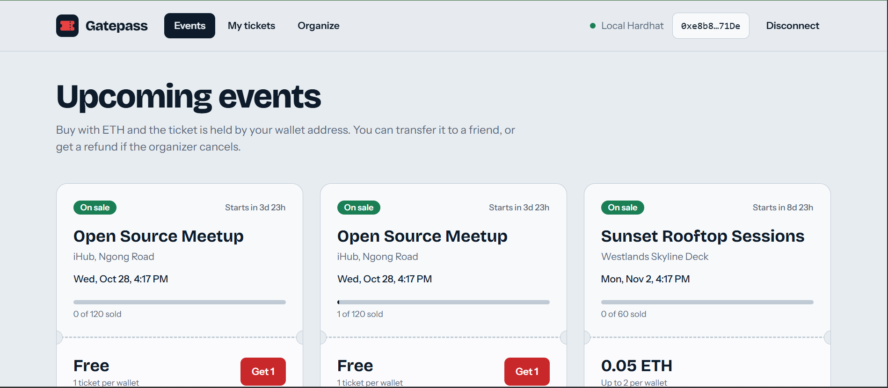
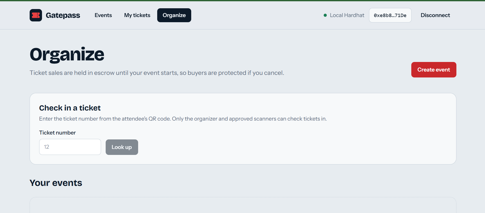
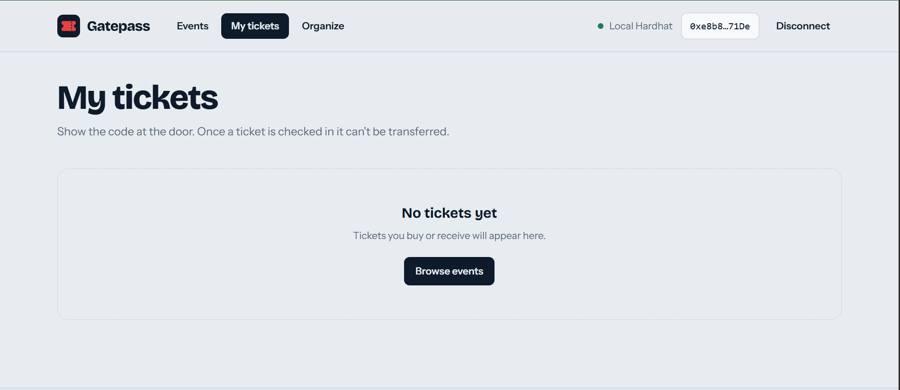
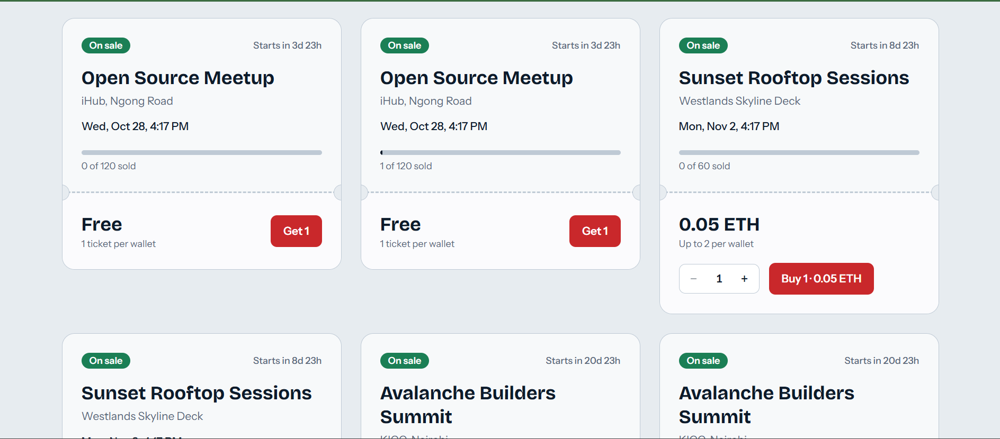

# Gatepass: on-chain event ticketing for Avalanche

Gatepass is a decentralized event ticketing dApp. Organizers create events, attendees buy tickets with AVAX, and every ticket lives on-chain: you can transfer it to a friend, show a QR code at the door, or claim a refund if the event is cancelled. Ticket sales are held in escrow until the event starts, so buyers are protected.

It is a ground-up rebuild of the original single-event prototype. See [What changed from v1](#what-changed-from-v1).

- **Smart contract:** Solidity 0.8.24, Hardhat, no external contract dependencies
- **Frontend:** React 19, Vite, Tailwind CSS 4, ethers v6
- **Network:** Avalanche Fuji testnet by default (also works on a local Hardhat node and C-Chain mainnet)

## Screenshots

### Dashboard



### Event Organization



### Tickets



### Ticket Details



## Features

**For attendees**

- Browse every event with live availability, countdowns and per-wallet limits
- Buy several tickets in one transaction
- See your tickets with a QR code, status (valid, used, cancelled) and event details
- Transfer a ticket to another wallet
- Claim a full refund when an organizer cancels

**For organizers**

- Create events with a price (or free), capacity, start time and per-wallet limit
- Cancel an event before it starts
- Withdraw proceeds once the event has started
- Check tickets in at the door, and approve extra "door staff" wallets to do the same

**Under the hood**

- Wallet connect with network detection and one-click switch/add for Avalanche chains
- Read-only browsing works without a wallet (public RPC)
- Friendly transaction flow: one toast follows each action from wallet prompt to confirmation, with a block explorer link
- Custom-error decoding, so failures show plain-language messages instead of raw revert data
- Accessible UI: keyboard focus styles, skip link, native `<dialog>`, reduced-motion support, responsive down to phones

## How it works

```
 Browser (React + ethers v6)
   |  read: public RPC (no wallet needed)
   |  write: injected wallet (Core / MetaMask)
   v
 Avalanche C-Chain (Fuji by default)
   v
 EventTicketing.sol
   events[]  tickets[]  escrow per event
```

### Money flow

1. A buyer pays `price x quantity` into the contract. The amount is recorded as **escrow for that event**.
2. If the organizer **cancels** before the start, every ticket holder can call `refund` and get the ticket price back. The organizer can never withdraw a cancelled event's funds.
3. Once the event **starts** (and was not cancelled), the organizer can call `withdrawProceeds` to collect the escrow. Sales close at the start time, so the amount is final.

### Contract API

`contracts/EventTicketing.sol`

| Function                                                                | Who                  | What it does                                                     |
| ----------------------------------------------------------------------- | -------------------- | ---------------------------------------------------------------- |
| `createEvent(name, venue, startTime, price, capacity, maxPerWallet)`    | anyone               | Creates an event; caller becomes organizer                       |
| `buyTickets(eventId, quantity)`                                         | anyone               | Mints tickets; `msg.value` must equal `price x quantity` exactly |
| `transferTicket(ticketId, to)`                                          | ticket owner         | Moves an unused ticket to another wallet                         |
| `refund(ticketId)`                                                      | ticket owner         | Burns the ticket and returns its price (cancelled events only)   |
| `cancelEvent(eventId)`                                                  | organizer            | Cancels before the start time                                    |
| `withdrawProceeds(eventId)`                                             | organizer            | Pays out escrow after the event has started                      |
| `setScanner(eventId, scanner, allowed)`                                 | organizer            | Approves or revokes door staff                                   |
| `checkIn(ticketId)`                                                     | organizer or scanner | Marks a ticket as used (once)                                    |
| `getEvent`, `getEvents(offset, limit)`, `getTicket`, `ticketsOf(owner)` | anyone               | Read helpers                                                     |
| `eventCount`, `ticketCount`, `escrow`, `purchased`, `isScanner`         | anyone               | Public state getters                                             |

Events emitted: `EventCreated`, `TicketsPurchased`, `TicketTransferred`, `TicketCheckedIn`, `EventCancelled`, `TicketRefunded`, `ProceedsWithdrawn`, `ScannerUpdated`.

### Security notes

- Funds are escrowed per event and only released under the rules above; there is no admin or owner key that can touch them.
- Withdrawals and refunds update state **before** sending funds and are protected by a reentrancy guard.
- Exact-payment check on purchases (no overpayment or silent change handling).
- Per-wallet limits apply to _purchases_, so a wallet can't free up allowance by transferring tickets away and buying more. Transfers themselves are not limited.
- Custom errors instead of revert strings (cheaper and easy to decode).

This is a learning and portfolio project. It has not been professionally audited. Do not use it with significant real funds without an audit.

## Project structure

```
event-ticketing-dapp/
├── contracts/
│   └── EventTicketing.sol        # the smart contract
├── test/
│   └── EventTicketing.test.js    # Hardhat + Chai test suite
├── scripts/
│   ├── deploy.js                 # deploys and records the address for the frontend
│   └── seed.js                   # creates demo events (and fake buyers locally)
├── hardhat.config.js
├── .env.example                  # deployer key and RPC overrides
└── frontend/
    ├── .env.example              # chain id, optional address/RPC override
    └── src/
        ├── App.jsx               # layout, transaction runner, tab routing
        ├── components/           # EventCard, MyTickets, Organizer, CreateEventDialog, ...
        ├── hooks/                # useWallet, useTicketing, useToasts, useNow
        ├── lib/                  # abi, chains, config, contract, format
        └── contracts/
            └── deployments.json  # { "<chainId>": { "address": "0x..." } }, written by deploy.js
```

## Getting started

### Prerequisites

- Node.js 18 or newer (20 LTS recommended)
- A browser wallet: [Core](https://core.app/) or MetaMask
- For Fuji: a throwaway wallet funded with test AVAX from the [Avalanche faucet](https://core.app/tools/testnet-faucet/?subnet=c&token=c)

### 1. Install

```bash
npm install                 # contract tooling (Hardhat)
npm run frontend:install    # frontend dependencies
```

### 2. Run the tests

```bash
npm test                    # run the contract test suite
npm run test:gas            # same, with a gas report
```

### 3a. Run everything locally

```bash
# terminal 1: local blockchain
npm run node

# terminal 2: deploy, add demo events and a few fake buyers
npm run deploy:local
npm run seed:local

# terminal 3: frontend pointed at the local chain
cd frontend
cp .env.example .env        # then set VITE_CHAIN_ID=31337
npm run dev
```

Open http://localhost:5173. In your wallet, add the local network (the app offers to do this when you click "Switch network"): RPC `http://127.0.0.1:8545`, chain id `31337`. Import one of the private keys printed by `npm run node` to get test funds.

> Those keys are public and only for local use. Never send real funds to them.

### 3b. Deploy to Avalanche Fuji

```bash
cp .env.example .env        # add PRIVATE_KEY (a throwaway testnet key, with or without 0x)
npm run deploy:fuji         # writes the address to frontend/src/contracts/deployments.json
npm run seed:fuji           # optional: create three demo events

cd frontend
cp .env.example .env        # VITE_CHAIN_ID=43113 is the default
npm run dev
```

You can also skip `deployments.json` and set `VITE_CONTRACT_ADDRESS` in `frontend/.env` (or in your hosting provider's environment variables).

### 4. Build and host the frontend

```bash
npm run build               # outputs frontend/dist
```

Deploy `frontend/dist` to any static host. On Vercel, set the root directory to `frontend`, the build command to `npm run build`, and add `VITE_CHAIN_ID` and `VITE_CONTRACT_ADDRESS` as environment variables.

## Configuration

| Variable                | Where           | Default                 | Purpose                                             |
| ----------------------- | --------------- | ----------------------- | --------------------------------------------------- |
| `PRIVATE_KEY`           | root `.env`     | none                    | Deployer key for Fuji/mainnet. Use a throwaway key. |
| `FUJI_RPC_URL`          | root `.env`     | public Fuji RPC         | Override the RPC used for deployment                |
| `AVALANCHE_RPC_URL`     | root `.env`     | public C-Chain RPC      | Override the RPC for mainnet deployment             |
| `VITE_CHAIN_ID`         | `frontend/.env` | `43113`                 | `43113` Fuji, `43114` C-Chain, `31337` local        |
| `VITE_CONTRACT_ADDRESS` | `frontend/.env` | from `deployments.json` | Contract to talk to                                 |
| `VITE_RPC_URL`          | `frontend/.env` | chain default           | Read-only RPC used before a wallet connects         |

Chain details (RPC URLs, explorers, faucet) live in `frontend/src/lib/chains.js`. The app name is a single constant in `frontend/src/lib/config.js`.

## Using the app

**As an attendee**

1. Open the Events tab. You can browse without a wallet.
2. Connect your wallet; if it is on another network, use the "Switch" button in the header.
3. Pick a quantity and press Buy. Confirm in your wallet.
4. Find your tickets under My tickets. Use Transfer to send one to a friend.

**As an organizer**

1. Open Organize and press Create event.
2. Share the Events page with attendees.
3. On the day, use Check in a ticket (enter the number shown under the attendee's QR code). Add door staff wallets with Door staff on each event.
4. After the event starts, press Withdraw proceeds.

## What changed from v1

The original project was a good first prototype, but it had problems that made it unsafe or broken. The rebuild fixes them:

| v1                                                                                                           | v2                                                                                                             |
| ------------------------------------------------------------------------------------------------------------ | -------------------------------------------------------------------------------------------------------------- |
| `withdraw()` had **no access control**, so anyone could drain the contract                                   | Funds are escrowed per event; only the organizer can withdraw, only after the event starts, never if cancelled |
| One hard-coded event, price and capacity                                                                     | Any number of events, each with its own price, capacity, start time and limits                                 |
| Contract capacity was 1000, UI showed 100                                                                    | Capacity comes from the contract and is shown consistently                                                     |
| Ticket list for the UI was kept in `localStorage`, so it was per-browser and wiped on disconnect             | All state is read from the chain; tickets follow the wallet on any device                                      |
| `BuyTicket.jsx` / `TicketList.jsx` used ethers v5 `ethers.utils.*` with ethers v6 installed, and were unused | One consistent ethers v6 code path; no dead components                                                         |
| `getSimpleTicketInfo` and `getUserTickets` were missing from the frontend ABI                                | ABI covers the whole contract and decodes custom errors                                                        |
| `hardhat.config.js` generated a **random wallet and printed its private key on every run**                   | Deployer key comes from `.env`; nothing is generated or logged                                                 |
| Leftover Hardhat sample files (`Lock.sol` tests/ignition, sample README)                                     | Removed; real tests for the real contract                                                                      |
| No refunds, transfers, check-in or cancellation                                                              | All four are implemented and tested                                                                            |
| Tickets could not be verified at the door                                                                    | Check-in with organizer/scanner permissions and QR codes                                                       |
| Alert dialogs for every message                                                                              | Toasts that follow each transaction, with explorer links and plain-language errors                             |

## Design decisions and limitations

- **Tickets are records, not ERC-721 tokens.** The contract tracks ownership, transfer and check-in itself, which keeps it small and dependency-free. The trade-off is that tickets do not show up in NFT wallets or marketplaces. Making `EventTicketing` an ERC-721 (for example with OpenZeppelin) is the natural next step.
- **No resale price controls.** Transfers are free and unrestricted until check-in. A royalty or price-cap rule could be added to `transferTicket`.
- **The frontend polls** every 15 seconds and after each transaction. It also reads every event in one call, which is fine for a few hundred events. For larger catalogs, page with `getEvents(offset, limit)` or index the emitted events with a subgraph.
- **Event details cannot be edited.** They are immutable after creation; organizers can cancel and re-create.
- **Door staff cannot be listed**, only approved or revoked by address (mappings are not enumerable). Listen for `ScannerUpdated` events if you need a list.
- **Name and venue are stored on-chain** (capped at 100 bytes each). Richer metadata such as images would go off-chain (IPFS) with a URI stored in the event.

## Troubleshooting

- **"Contract not deployed yet" screen:** no address is configured for the selected chain. Run the deploy script, or set `VITE_CONTRACT_ADDRESS`, then restart `npm run dev`.
- **"Couldn't load from ..." banner:** the RPC is unreachable or the address has no contract on that chain. Check `VITE_CHAIN_ID` matches where you deployed. After restarting a local `hardhat node`, redeploy, since the chain state resets.
- **Wallet shows the wrong network:** press "Switch to ..." in the header. For local Hardhat, your wallet may need the network added manually.
- **Transactions fail with "insufficient funds":** get test AVAX from the faucet, and remember each purchase also needs a little gas.
- **Invalid private key error on deploy:** `PRIVATE_KEY` in `.env` must be a 64-character hex string (with or without a `0x` prefix).
- **Nonce errors after restarting the local node:** reset the account in your wallet (MetaMask: Settings > Advanced > Clear activity tab data).

## Tech stack

Solidity 0.8.24, Hardhat 2 with the Hardhat Toolbox (ethers v6, Chai matchers, network helpers), React 19, Vite 7, Tailwind CSS 4, ethers 6, qrcode.react. Fonts: Bricolage Grotesque and Instrument Sans via Google Fonts.

## License

MIT. See [LICENSE](LICENSE).
